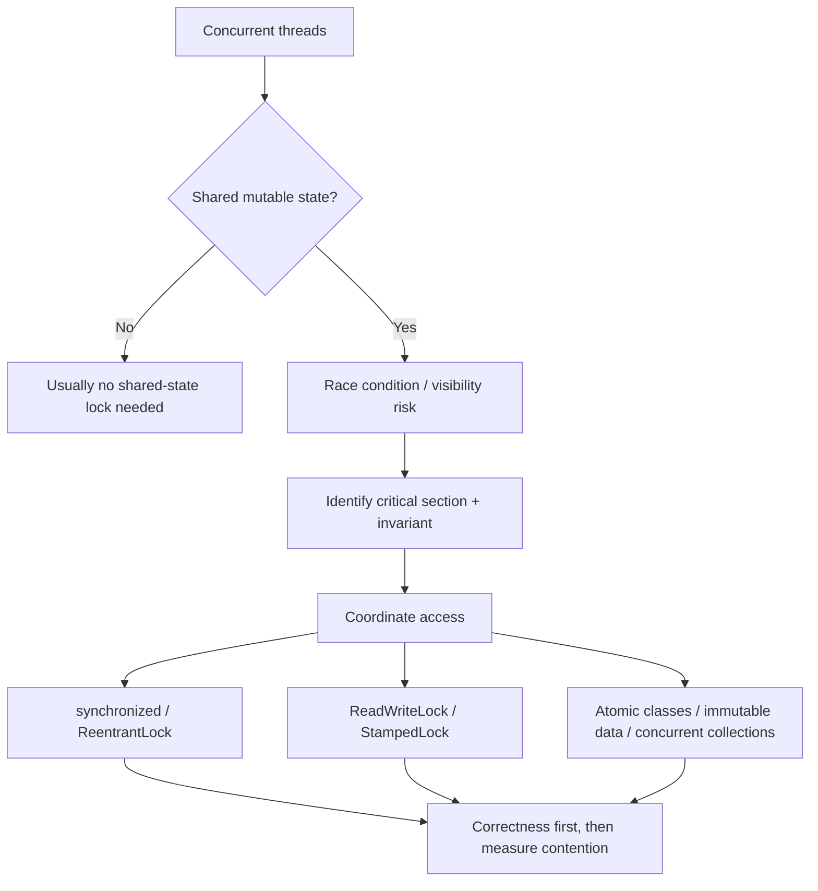
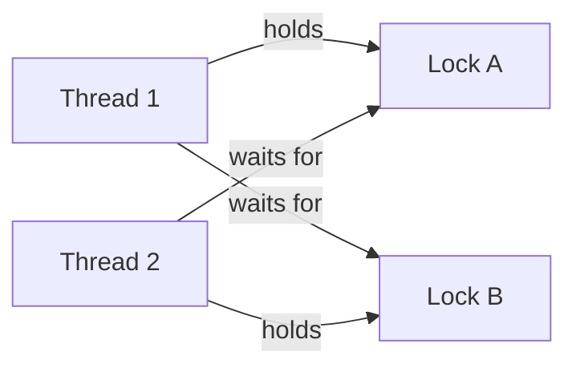

# Java Concurrency — Locks and Synchronization

> **Purpose:** Core concepts + practical interview revision (Java 17). Consolidated from my July 2025 Markdown notes, handwritten/typed screenshots, and follow-up technical review. Original topics and examples are retained, but technical misconceptions are corrected.

## 0. Five-minute revision

- **Concurrency:** Multiple tasks make progress during overlapping time periods; they do *not* necessarily run simultaneously. **Parallelism:** tasks literally execute at the same time on available processing resources.
- **Shared mutable state** accessed by multiple threads can create a **race condition**. A **critical section** is code that accesses that state and needs coordination.
- **Mutual exclusion:** only one thread at a time enters a protected critical section using the *same* exclusive lock. Proper synchronization also provides memory-visibility / happens-before guarantees.
- **`synchronized`:** implicit, reentrant intrinsic monitor; automatically releases on block exit. **`ReentrantLock`:** explicit, reentrant lock; always `unlock()` in `finally`.
- **`ReentrantReadWriteLock`:** shared reads, exclusive writes; possible **write → read downgrade**, but direct **read → write upgrade** is unsupported.
- **`StampedLock`:** write locking, read locking and **optimistic reads** with validation; **not reentrant**.
- **`Condition.await()`** releases the associated lock while waiting, then reacquires it before returning. Always guard a condition with a `while` loop.
- **Fairness ≠ guaranteed FIFO scheduling**; fair locks may reduce throughput. **Locks do not automatically prevent deadlock**.
- Choose based on access patterns and measurements: start simple (`synchronized`), then use specialized locks only when justified.

## 1. Mental model: from concurrency to locks



**Monitor:** Every Java object can act as an intrinsic monitor for `synchronized`. Its ownership is exclusive and reentrant; `wait()`/`notify()`/`notifyAll()` use that monitor's wait set. Don't confuse the intrinsic monitor with the `Lock`/`Condition` API.

**Thread coordination vs. execution order:** We coordinate access and establish ordering/visibility relationships; locking does **not** generally prescribe which thread runs next.

**Contention:** competing threads need the **same constrained resource/lock** and at least one must wait (or retry). Merely reading the same immutable variable concurrently is not necessarily contention. High contention can mean blocking, context switches and reduced throughput.

## 2. `synchronized` vs. `ReentrantLock`

| Feature | `synchronized` | `ReentrantLock` |
|---|---|---|
| Type | Java keyword / intrinsic monitor | `java.util.concurrent.locks` class implementing `Lock` |
| Mutual exclusion + visibility | Yes, if participants use same monitor correctly | Yes, if participants use same lock correctly |
| Reentrant | Yes | Yes, with hold count |
| Acquire/release | Automatically on entry/exit (including exception) | Explicit `lock()` / `unlock()` in `finally` |
| Interrupt while *acquiring* | Not interruptible | `lockInterruptibly()` |
| Acquisition timeout | No | `tryLock(timeout, unit)` |
| Fair option | No fair-mode setting | `new ReentrantLock(true)` |
| Wait/signal | `wait()`/`notify()`/`notifyAll()` on monitor | `Condition.await()`/`signal()`/`signalAll()` |
| Diagnostics | JVM thread dumps and monitor tools | Methods such as `isLocked()`, `getHoldCount()`, `hasQueuedThreads()` (some are estimates/monitoring) |
| Performance | Workload/JVM dependent | Workload/JVM dependent; **neither universally faster** |
| Best use | Simple critical sections | Timed/interruptible attempts, multiple conditions or explicit control |

**Choose:** prefer `synchronized` for ordinary short critical sections. Use `ReentrantLock` when its **specific capabilities** are needed; choosing it does not inherently increase performance or eliminate deadlock.

### Reentrancy and hold count

A thread that owns a reentrant lock can enter another method using **that same lock** without deadlocking itself. Every successful `lock()` needs a matching `unlock()`; only the **final** unlock releases ownership to another thread.

```java
import java.util.concurrent.locks.ReentrantLock;

public class ReentrantExample {
    private final ReentrantLock lock = new ReentrantLock();

    void tryToOpenPasswordProtectedFile() {
        lock.lock();                 // hold count = 1
        try {
            System.out.println("Trying to open a file...");
            enterPasswordAndOpenFile();
        } finally {
            lock.unlock();          // second release; hold count = 0
        }
    }

    void enterPasswordAndOpenFile() {
        lock.lock();                 // same thread; hold count = 2
        try {
            System.out.println("Entered password and opened the file");
        } finally {
            lock.unlock();          // hold count = 1
        }
    }

    public static void main(String[] args) {
        new ReentrantExample().tryToOpenPasswordProtectedFile();
    }
}
```

> **Interview trap:** `lock()` is *not* automatically paired with `unlock()`. Missing an unlock can block other threads indefinitely. Do not put `lock()` inside `try` and then assume it was acquired when using interruptible/timed forms; acquire first, then enter `try/finally` after success.

### How to acquire a `ReentrantLock`

| Operation | Behavior |
|---|---|
| `lock()` | Waits until acquired; ordinary waiting does not react to interruption by throwing |
| `lockInterruptibly()` | Waits but throws `InterruptedException` if interrupted during acquisition |
| `tryLock()` | Returns immediately with `true` or `false`; may **barge** even on a fair lock |
| `tryLock(timeout, unit)` | Waits up to timeout; interruptible while waiting; returns success/failure |
| `unlock()` | Releases one hold; must be called only by owner |

```java
if (lock.tryLock()) {
    try {
        // protected operation
    } finally {
        lock.unlock();
    }
} else {
    // choose a safe fallback or retry strategy
}
```

### Fairness

`new ReentrantLock(true)` aims to favor the **longest-waiting queued thread under contention**. It is **not strict thread-execution FIFO**; operating-system scheduling still matters, and untimed `tryLock()` can barge. Fairness can reduce throughput; default is **nonfair**.

### `Condition` = explicit waiting/notification

- Similar *purpose* to `Object.wait()`/`notify()`, but associated with a `Lock` rather than an intrinsic monitor.
- `await()` must be called while holding the lock; it **releases** that lock while waiting and **reacquires** it before returning.
- `signal()` wakes an eligible waiter; it does **not immediately transfer ownership**. Signaling thread must release the lock before a waiter can resume protected work.
- Always check the condition in a **`while` loop** due to spurious wakeups and changed conditions.

```java
lock.lock();
try {
    while (!ready) {
        condition.await();  // releases lock, waits, reacquires lock
    }
    // do work when ready
} finally {
    lock.unlock();
}
```

`await()` throws `InterruptedException`; calling code must catch/propagate it appropriately. Multiple `Condition` instances can represent separate waiting groups on one lock.

## 3. `ReentrantReadWriteLock`

**Idea:** many readers can hold the **read lock simultaneously**, but a writer requires the **write lock exclusively**. Thus, protect a shared data structure where reads greatly outnumber writes and actual contention makes that beneficial.

- **ReadLock:** shared with other readers *when acquisition policy permits*; not concurrently with another thread's writer.
- **WriteLock:** exclusive against other threads' readers/writers.
- Read and write modes are **reentrant** for permitted acquisitions.
- Both require explicit `lock()` and `unlock()`.
- Fair constructor: `new ReentrantReadWriteLock(true)`. **Default nonfair mode does not guarantee writer priority**, and starvation is possible. Fair mode has documented reader/writer acquisition rules; do not equate it with a universal FIFO schedule.
- **Downgrading (write → read): allowed.** Hold write lock, acquire read lock, then release write lock.
- **Upgrading (read → write): not supported.** Releasing read lock first and then taking write lock is possible, but **not atomic**: another thread may modify the data in between; recheck assumptions.

### Original working example (tidied)

```java
import java.util.concurrent.locks.ReentrantReadWriteLock;

public class ReadWriteExample {
    private final ReentrantReadWriteLock lock = new ReentrantReadWriteLock();
    private final ReentrantReadWriteLock.ReadLock readLock = lock.readLock();
    private final ReentrantReadWriteLock.WriteLock writeLock = lock.writeLock();
    private int sharedResource = 0;

    public void readData() {
        readLock.lock();
        try {
            System.out.println(Thread.currentThread().getName()
                    + " reading: " + sharedResource);
            Thread.sleep(500); // illustrative slow operation
        } catch (InterruptedException e) {
            Thread.currentThread().interrupt();
        } finally {
            readLock.unlock();
        }
    }

    public void writeData(int value) {
        writeLock.lock();
        try {
            System.out.println(Thread.currentThread().getName()
                    + " writing: " + value);
            sharedResource = value;
            Thread.sleep(500); // illustrative slow operation
        } catch (InterruptedException e) {
            Thread.currentThread().interrupt();
        } finally {
            writeLock.unlock();
        }
    }

    public static void main(String[] args) {
        ReadWriteExample example = new ReadWriteExample();
        for (int i = 0; i < 3; i++) {
            new Thread(example::readData, "Reader-" + i).start();
        }
        new Thread(() -> example.writeData(42), "Writer").start();
    }
}
```

**Why this example works:** readers can overlap if they hold only the read lock; a writer cannot overlap them. **Note:** `Thread.sleep()` here is only to visualize lock holds; in real code avoid unnecessary long operations under locks. Timing/output order will vary.

### Reader-writer problem: important nuance

Example: T1 and T2 already hold the read lock; writer T3 is waiting. Whether *new* reader T4 may acquire the read lock depends on fair/nonfair policy and state. It is **incorrect** to say “all new readers always wait once any writer starts waiting.” Also, optimizing throughput with many readers can **starve writers** unless acquisition policy/workload is considered.

### Decision rule

Use it for a **genuinely read-dominated shared mutable structure**, with sufficiently substantial read work. For short operations, copying/immutability, `ConcurrentHashMap`, `synchronized` or `ReentrantLock` may be simpler/faster. Always consider measurement.

## 4. `StampedLock`

`StampedLock` (`java.util.concurrent.locks`) supports **three access modes**:

1. **Write lock:** exclusive; returns a stamp.
2. **Read lock:** shared pessimistic read lock; returns a stamp.
3. **Optimistic read:** `tryOptimisticRead()` gets a stamp **without obtaining a traditional read lock**; read data, then verify with `validate(stamp)`.

**Important:** `StampedLock` is **not reentrant**. Nested acquisition can block indefinitely or otherwise misbehave. Stamps are tokens identifying lock states, not ownership records attached to a Java thread. `StampedLock` isn't a drop-in replacement for `ReentrantLock`.

```java
import java.util.concurrent.locks.StampedLock;

class Point {
    private final StampedLock lock = new StampedLock();
    private double x, y;

    double distanceFromOrigin() {
        long stamp = lock.tryOptimisticRead();
        double localX = x, localY = y;  // provisional snapshot
        if (!lock.validate(stamp)) {
            stamp = lock.readLock();
            try {
                localX = x;
                localY = y;
            } finally {
                lock.unlockRead(stamp);
            }
        }
        return Math.hypot(localX, localY);
    }

    void move(double dx, double dy) {
        long stamp = lock.writeLock();
        try {
            x += dx;
            y += dy;
        } finally {
            lock.unlockWrite(stamp);
        }
    }
}
```

**Why validate?** A writer may change the data during the optimistic read. If validation fails, reread using a real read lock. The optimistic snapshot is **not safe to act upon until validated**; avoid dereferencing possibly inconsistent object graphs in an unvalidated optimistic read.

### Optimistic vs. pessimistic

| Topic | Pessimistic | Optimistic |
|---|---|---|
| Mental model | Protect access *before* working | Proceed speculatively, then **check** consistency |
| Blocking | Lock acquisition can block | Initial speculative read generally avoids blocking |
| Conflict outcome | Others wait until lock is available | Validation failure, retry or locked fallback |
| Example | `synchronized`, `ReentrantLock`, `readLock()` | `StampedLock.tryOptimisticRead()`, database/JPA version checks |
| Best fit | Conflicts are common / strict exclusion is needed | Read-heavy workloads with relatively few writes |

**Correction:** Optimistic locking does **not** generally “lock after verification”; it typically *checks a version/stamp* and retries/falls back if changed. And optimistic read **doesn't provide exclusive access**.

**`StampedLock` reader-writer variants:**
- `readLock()` = pessimistic shared read; writer needs exclusive access.
- `writeLock()` = exclusive write.
- `tryOptimisticRead()` = no conventional read-lock ownership, requires validation.
- Unlike a simple `ReentrantReadWriteLock`, `StampedLock` also provides conversion methods (e.g., `tryConvertToWriteLock(stamp)`), **but conversion is conditional and may fail**; it is not unrestricted read-to-write upgrading.

## 5. Deadlock and lock ordering

**Deadlock:** T1 holds lock A and waits for B while T2 holds B and waits for A; neither can progress.



- **Consistent order:** Always acquire A then B across all threads; strongly helps prevent circular-wait deadlock involving those locks.
- **`tryLock` + bounded timeout:** can give a fallback strategy instead of waiting forever, **if** partial acquisitions are properly released.
- **`lockInterruptibly()`:** lets waiting acquisition be interrupted; it does not itself make application deadlock-free.
- **Short critical sections:** reduce contention, but aren't a proof against deadlock.
- **Fair locks:** do *not* eliminate deadlocks.

## 6. Practical decisions for interviews

| Scenario | First choice / consideration | Why |
|---|---|---|
| Small shared counter | `AtomicInteger` or properly synchronized access | Avoid lost updates |
| Short protected update | `synchronized` | Simpler ownership/lifecycle |
| Need timeout / cancellation while acquiring | `ReentrantLock` | Timed / interruptible acquisition |
| Separate waiting conditions | `ReentrantLock` + `Condition` | Explicit wait queues |
| Many reads, few writes, meaningful lock contention | `ReentrantReadWriteLock` | Concurrent readers |
| Read-heavy and mostly uncontended writes, simple snapshot | Consider `StampedLock` | Optimistic validation may help |
| Shared map with independent updates | `ConcurrentHashMap` | Often better than hand-managed global locking |
| Read-mostly immutable configuration | Immutable snapshot / volatile reference | Often simpler than manual locking |

**Spring Boot perspective:** singleton beans may serve multiple threads concurrently. If a bean mutates shared state, choose a safe design; merely being a Spring bean does **not** make that state thread-safe. A lock guards only threads/processes coordinating through that **same lock instance**. A `ReentrantLock` in one JVM **does not synchronize two different application instances**; distributed coordination requires a separate mechanism if needed.

## 7. Corrected statements from my earlier notes / screenshots

1. **“Contention = multiple threads access same variable.”** Refine: contention occurs when they *compete* for a restricted resource/lock; concurrent immutable reads need not contend.
2. **“Pessimistic locking guarantees thread safety.”** Only if *all relevant accesses use the protocol correctly* and the protected invariant is sound.
3. **“A waiting writer blocks all new readers.”** Not universally true for `ReentrantReadWriteLock`; mode/policy matters.
4. **“Fair mode means strict FIFO execution.”** No; it is a lock-acquisition policy, not a scheduler guarantee.
5. **“ReentrantLock is faster than synchronized.”** Neither is always faster; benchmark workload/JVM.
6. **“`StampedLock` optimistic read is just a read lock.”** No; it is stamp-and-validate without traditional read-lock acquisition.
7. **“Optimistic locking acquires a lock after checking.”** Not necessarily; version/stamp validation is central.
8. **“Read lock to write lock upgrade is possible if I release the read lock.”** Release-and-reacquire is a *new acquisition*, not atomic upgrade; state can change meanwhile.
9. **“ReentrantLock prevents deadlock.”** No. Lock order and lifecycle determine safety.
10. **“Locks make all shared state safe.”** Only the state/access paths actually protected under consistent locking; don't forget visibility, invariants and cross-instance boundaries.
11. **“`Condition.signal()` hands off the lock immediately.”** No; the signaling thread still owns it until unlock.
12. **“StampedLock is always best for read-heavy apps.”** No; optimistic validation retries, reader work and correctness details may outweigh gains.

## 8. Interview questions — fast answers

1. **Why synchronize?** Preserve shared-state invariants through mutual exclusion and memory-order/visibility guarantees.
2. **What's reentrancy?** The owner thread can acquire the same lock again; balanced unlocks still required.
3. **Why not always use `ReentrantLock`?** More explicit lifecycle complexity; simple `synchronized` is often sufficient.
4. **How does `tryLock()` differ from `lock()`?** Immediate success/failure vs. waiting to acquire.
5. **What is `lockInterruptibly()`?** Interruptible wait for lock acquisition.
6. **Fair lock = FIFO?** Not a strict execution FIFO; fairness rules govern acquisition under contention.
7. **Why `Condition.await()` inside `while`?** Spurious wakeups and predicate changes; await releases and reacquires lock.
8. **Read lock vs. write lock?** Shared reads / exclusive writes.
9. **Can a read lock be upgraded to write lock?** Not directly with `ReentrantReadWriteLock`; release/recheck or redesign.
10. **Can you downgrade a write lock?** Yes: acquire read while owning write, then release write.
11. **What is optimistic read?** Read provisionally without conventional read lock; validate stamp and fallback if invalid.
12. **Is `StampedLock` reentrant?** No.
13. **What is deadlock?** Circular waiting for held locks; mitigate through consistent ordering.
14. **Does a lock work across two Spring Boot instances?** No, ordinary JVM locks are process-local.
15. **How choose a lock?** Start from correctness and access pattern; choose minimal primitive, measure contention before specialization.

## 9. Thirty-second interview explanation

> "When multiple threads access shared mutable state, I first identify the invariant and critical section. For simple mutual exclusion, I use `synchronized`; both it and `ReentrantLock` are reentrant. If I need timed or interruptible acquisition, fairness configuration, or multiple waiting conditions, I use `ReentrantLock` with `try/finally`. For read-dominant shared structures, `ReentrantReadWriteLock` can allow concurrent readers while keeping writes exclusive. `StampedLock` additionally supports optimistic reads with validation, but it is not reentrant. I keep lock order consistent to avoid deadlocks and select specialized locks based on actual contention rather than assuming they are always faster."

---

### Revision checklist

- [ ] Explain monitor, race condition, critical section, atomicity and visibility.
- [ ] Explain `synchronized` vs. `ReentrantLock` without performance myths.
- [ ] Explain reentrancy, hold count, `tryLock`, fairness and `Condition`.
- [ ] Explain ReadWriteLock reader/writer behavior, downgrade and failed upgrade.
- [ ] Explain StampedLock read/write/optimistic modes and validation.
- [ ] Explain optimistic vs. pessimistic locking, contention and deadlock.
- [ ] Explain why JVM locks do not coordinate separate Spring Boot instances.
