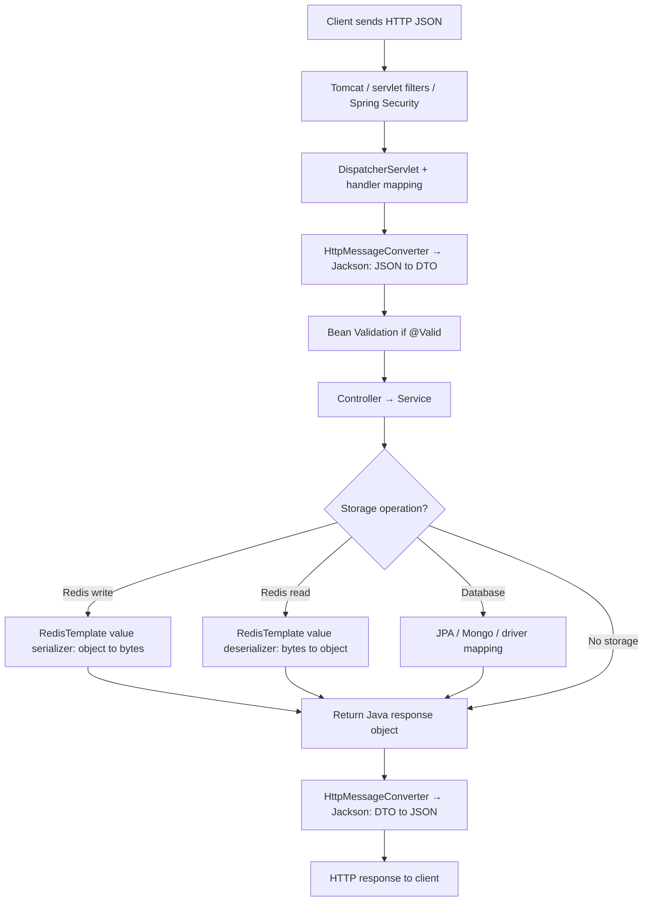
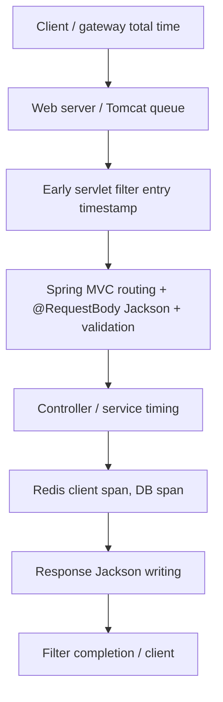

# Serialization & Deserialization — Java, Spring Boot, Redis

> **Interview revision notes | Java 17 / Spring Boot | Fundamentals → production scenarios**

## 1. Mental model (start here)

- **Serialization:** Convert an in-memory object/value into a representation that can be stored or transmitted (JSON, binary, etc.).
- **Deserialization:** Read that representation and reconstruct the corresponding value/object.
- This concept is **language-independent**: Java, Python, JavaScript, Go, C#, etc. exchange data using agreed formats.
- **Not every HTTP request needs Jackson or JSON**: bodies may be text, bytes, form data, etc. Encoding a string as UTF-8 bytes is usually called *encoding*; in Redis terminology it is also handled by a `RedisSerializer`.
- **Important distinction:** *Format* (JSON, Java native binary, Protocol Buffers) vs. *library* (Jackson, Gson) vs. *framework integration* (Spring MVC `HttpMessageConverter`, `RedisTemplate`).

| Boundary | Direction | Responsible component |
|---|---|---|
| HTTP request JSON → DTO | Deserialization | Spring MVC message converter delegates to Jackson by default |
| DTO → HTTP response JSON | Serialization | Spring MVC message converter delegates to Jackson |
| Java object → Redis value bytes | Serialization | `RedisTemplate` **configured value serializer** |
| Redis value bytes → Java object | Deserialization | `RedisTemplate` **configured value serializer** |
| Redis key `String` ↔ bytes | Encoding / decoding | Commonly `StringRedisSerializer` (UTF-8) |
| Java entity ↔ database | Persistence mapping / conversion | JPA, MongoDB mapping, drivers, database protocol; **not necessarily Jackson** |

## 2. End-to-end Spring Boot request flow



- **Request:** JSON deserialization (and optional validation) occurs **before the controller method executes**.
- **Response:** JSON serialization normally occurs **after the controller returns**.
- `@RestController` + Spring MVC is the conventional servlet REST stack; **WebFlux** has its own reactive request handling and codecs.
- `HttpMessageConverter` is **not an HTTP/2 deserializer**. HTTP/2 is a transport protocol, unrelated to the Jackson JSON conversion choice.

### Two concrete API flows (count the conversions)

**POST `/users`** with `@RequestBody UserDTO user`, Redis `set`, then return `user`:
1. HTTP JSON → `UserDTO` (Jackson **deserialize**).
2. `UserDTO` → Redis bytes (configured value serializer **serialize**).
3. `UserDTO` → HTTP JSON (Jackson **serialize**).

**GET `/users/{id}`** reading from Redis and returning DTO:
1. Spring MVC binds the `{id}` path text to a `String` (**no JSON deserialization of the path variable**).
2. Redis bytes → `UserDTO` (**deserialize**).
3. `UserDTO` → HTTP JSON (**serialize**).

> Counts above focus on **value/object conversions**; Redis key strings are separately encoded to bytes.

## 3. Java native serialization vs JSON

| Feature | Java native | Jackson JSON |
|---|---|---|
| API | `ObjectOutputStream.writeObject`, `ObjectInputStream.readObject` | `ObjectMapper.writeValueAsString`, `readValue` |
| Format | Java-specific binary object stream | JSON text |
| `implements Serializable` required? | **Yes**, for ordinary objects in the serialized graph | **No** |
| Typical use | Legacy Java-to-Java data persistence/exchange | REST APIs and interoperable data |
| Versioning | `serialVersionUID` compatibility | JSON field/schema evolution and mapper settings |

```java
String json = objectMapper.writeValueAsString(user); // Java object → JSON (serialization)
UserDTO user2 = objectMapper.readValue(json, UserDTO.class); // JSON → object (deserialization)
```

**Java native specifics**
- `Serializable` is a marker interface. All non-null reachable objects serialized by default must also be serializable unless excluded or custom-handled.
- `transient` instance fields are excluded from **default native serialization**; on deserialization they generally have JVM default values (`0`, `false`, `null`).
- `static` belongs to the class, **not** the serialized object. If `company` is changed to `"Google"` after serializing, deserializing the object does **not** reset that static field.
- A snapshot is stored: serialize `name="John"`, change live object to `"David"`, deserialize original bytes → `"John"`.
- `serialVersionUID` is a **compatibility identifier, not a serialization formula**. A different UID typically yields `InvalidClassException`. With same UID, compatible additions/removals may work; newly added primitive fields default to `0`, reference fields to `null`, removed fields are ignored.
- A non-serializable referenced `Department` value typically causes `NotSerializableException`. If reference is `null`, no problem.
- **Advanced, defer until later:** constructors of serializable classes are skipped by native deserialization, but an accessible no-arg constructor of the first non-serializable superclass is invoked.
- **Safety:** Avoid deserializing untrusted Java native serialized data; prefer restricted, well-defined formats and validation.

## 4. Jackson and DTO rules

```java
class UserDTO {
    public String name;
    @JsonProperty(access = JsonProperty.Access.WRITE_ONLY)
    public String password; // accepted from JSON, never included in outgoing JSON
}
```

- `@JsonIgnore`: excludes property from normal JSON serialization **and** deserialization.
- `@JsonProperty(access = WRITE_ONLY)`: accept in request, omit in response. Separate request/response DTOs are often even clearer.
- `@JsonInclude(Include.NON_NULL)`: can omit `null` properties.
- Jackson commonly respects `transient`, but use Jackson annotations to make **JSON-specific intent explicit**.
- **Missing JSON field**: generally Java default (`null` for `String`, `0` for `int`) if no initializer, constructor defaults, or custom rules.
- **Extra JSON field**: default Spring Boot Jackson setup generally ignores unknown properties; plain Jackson `ObjectMapper` typically fails unless configured.
- **Wrong type**: `"age": "thirty"` for `int age` normally causes Jackson `InvalidFormatException` (wrapped by Spring MVC as `HttpMessageNotReadableException` → usually HTTP **400**). `"30"` may be coerced depending on settings.
- With `@Valid @RequestBody`, a missing `@NotNull` property is deserialized first, then validation may throw `MethodArgumentNotValidException` → usually HTTP **400** *before controller execution*. Without `@Valid` (and absent other validation triggers), a field-level `@NotNull` alone typically does not trigger controller argument validation.

## 5. Redis: who serializes, and why configuration matters

**Redis stores byte strings; it does not understand `UserDTO` or automatically choose Jackson.** Spring application's `RedisTemplate` serializer controls conversion.

| Redis serializer | Data representation | DTO needs `Serializable`? |
|---|---|---|
| `JdkSerializationRedisSerializer` | Java native object bytes | **Yes** for non-null DTO value |
| `Jackson2JsonRedisSerializer<UserDTO>` | JSON bytes | **No** |
| `StringRedisSerializer` | String encoded as UTF-8 bytes | **No**, for string values/keys |

- Declaring `RedisTemplate<String, UserDTO>` **does not choose the serializer**. An ordinary `RedisTemplate` defaults to JDK serialization unless configured; auto-configured templates and custom application beans can differ, so always check the actual bean settings.
- Key and value serializers are independently configured; a String key often uses `StringRedisSerializer`.
- The Redis command may take ~5 ms while conversion and the full HTTP request take much longer. Do not conclude payload is small or Jackson is slow from that timing alone.

### Distributed compatibility and safe migrations

**Instance A (JDK bytes) → Redis → Instance B (Jackson JSON reader) = format mismatch and failure.** Casting raw bytes to a DTO cannot fix it: first decode using the matching format, then cast if appropriate.

Migration options:
1. **Clear/rebuild** only if keys are disposable cache entries (never blindly clear sessions/critical Redis data).
2. **Version keys**: `user:v1:123` → `user:v2:123`, then let old keys expire.
3. **Migrate**: read with old serializer, transform, write with new serializer.

**Schema evolution with JSON**
- Writer saves `{"name":"John","age":30}`; newer reader has `email` → `email=null` (typical DTO).
- Writer adds `email`; older Spring Boot reader ordinarily ignores unknown `email` by default.
- Writer changes `age` from number to `"thirty"` → incompatible for an `int` reader.
- Multiple instances must agree on representation, key naming, DTO compatibility, and serializer configuration.

## 6. Performance: essential concepts, not a separate monitoring syllabus

Serialization can affect **CPU**, **allocations/GC**, **payload size/network**, **latency** and **throughput**. Binary formats can be more compact for some workloads, but **JSON vs JDK vs Protobuf performance must be measured** with realistic payloads. Avoid claiming one format is always best.

Example: HTTP takes **150 ms**, Redis operation measures **5 ms**. That does **not** prove deserialization costs 145 ms. The remaining time may include Tomcat queuing, filters/security, JSON request parsing, validation, service logic, DB work, JSON response writing, network, or GC.

### How to locate a delay when controller logs don't appear



**Diagnostic sequence (interview answer):**
1. Compare client / load balancer time with server HTTP duration (Spring Boot Actuator + Micrometer).
2. Add an appropriately ordered `OncePerRequestFilter` timer to cover **downstream** processing, even when controller is never invoked. An ordinary filter does not measure stages before itself or Tomcat thread queueing; output response writing is typically downstream.
3. Compare with a timer inside the controller/service and Redis/DB client spans. An absent controller log can mean request-body deserialization or validation failed **before method invocation**.
4. For fine breakdown, instrument message-conversion steps or profile Jackson CPU/allocation with **JFR**; OpenTelemetry often needs custom instrumentation for detailed Jackson spans.
5. Measure p95/p99, payload sizes, CPU and GC before changing serializers.

> **Scope note:** Micrometer, tracing, JFR and optimization are *next topics*. For serialization interviews, know **where you'd measure** and **why a 5 ms Redis measurement isn't full endpoint latency**.

## 7. Exception cheat sheet

| Failure | Typical exception / result |
|---|---|
| Object graph includes non-serializable object (JDK) | `NotSerializableException` |
| Native stream's UID incompatible with class | `InvalidClassException` |
| Jackson value `"thirty"` for `int` | `InvalidFormatException` |
| Unknown JSON property with strict Jackson | `UnrecognizedPropertyException` |
| Spring MVC JSON conversion fails | `HttpMessageNotReadableException` → HTTP 400 |
| Bean Validation on `@Valid @RequestBody` fails | `MethodArgumentNotValidException` → HTTP 400 |
| Redis has JDK bytes but expects JSON | JSON read/Redis serialization exception (exact wrapper varies) |

## 8. Interview quick answers (memorize the reasoning)

1. **Does Spring JSON DTO need `Serializable`?** No. Jackson JSON mapping doesn't require Java's marker interface.
2. **Who performs conversion for REST?** Spring MVC chooses a message converter; Jackson performs JSON mapping by default.
3. **Does Spring MVC handle every HTTP API in Spring Boot?** No. Spring WebFlux is an alternative; not every response uses JSON.
4. **Does Redis automatically serialize `UserDTO` using Jackson?** No. The app's Redis serializer does it; inspect `RedisTemplate` configuration.
5. **Is `String` → UTF-8 bytes serialization?** Usually called character encoding; `StringRedisSerializer` handles it using the serializer abstraction.
6. **What happens if you change Redis JDK serializer to Jackson?** Existing bytes remain JDK-format; use old reader, migrate, or version keys; don't cast bytes.
7. **Two instances, JSON adds a nullable `email`?** Older JSON missing `email` → `null` in a typical newer DTO.
8. **What does `transient` do?** Excludes a field from default native serialization; Jackson-specific output rules should use annotations.
9. **Does `serialVersionUID` convert data?** No, it's an identifier used for native serialized class compatibility.
10. **Why might controller log not appear?** Deserialization or validation happens before method entry; filters/tracing can inspect earlier stages.
11. **Is response serialization before controller returns?** No. Spring MVC normally serializes the response after the controller returns its object.
12. **Does changing the serializer always boost performance?** No. Benchmark with actual payloads and look at full request metrics.

## 9. 30-second interview answer

> Serialization converts an object's data into a transportable or storable representation; deserialization reconstructs it. In Spring MVC, an HTTP message converter usually delegates JSON request and response mapping to Jackson. `Serializable` is specific to Java native object serialization and isn't required for REST JSON DTOs. For Redis, `RedisTemplate` uses explicitly or implicitly configured key/value serializers; Redis only stores bytes. A common production concern is format/schema compatibility across app versions, especially when multiple instances share Redis. Serialization also has CPU, memory, and network costs, so I would profile and measure request latency before optimizing the format.

---

**Revision boundary:** Native serialization constructor hierarchy, custom `readObject`/`writeObject`, and advanced JFR instrumentation can be learned later; the flows, formats, Redis settings and common failure modes above are the current priority.
